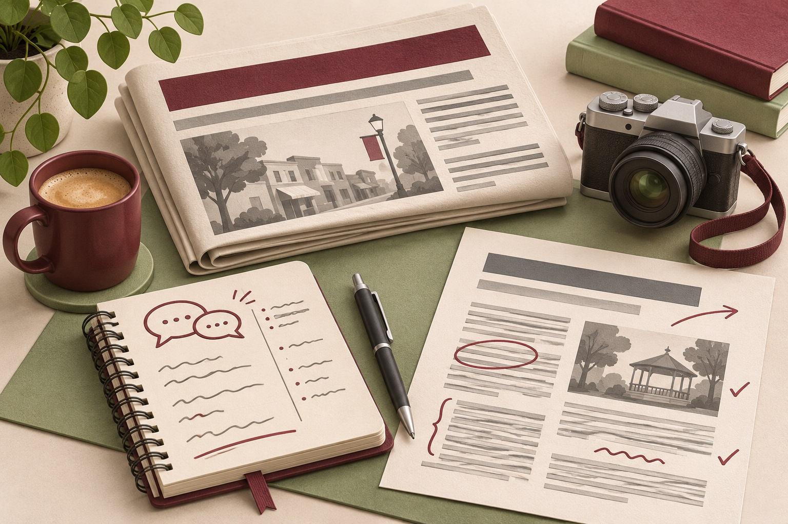

# Illustrations ajoutées le 22 novembre 2026

Six illustrations conceptuelles produites avec Imagegen intégré. Les prompts exacts et la provenance sont conservés dans les briefs par projet. Les originaux générés sont conservés ; les fichiers JPEG sont les copies utilisées dans l’application.

## P071

[Brief et prompt final](p071.md) · [Fiche française](../../../app/main/content/docs/realizations/p071.fr.md) · [Fiche anglaise](../../../app/main/content/docs/realizations/p071.en.md)

## P072

[Brief et prompt final](p072.md) · [Fiche française](../../../app/main/content/docs/realizations/p072.fr.md) · [Fiche anglaise](../../../app/main/content/docs/realizations/p072.en.md)

## P073

[Brief et prompt final](p073.md) · [Fiche française](../../../app/main/content/docs/realizations/p073.fr.md) · [Fiche anglaise](../../../app/main/content/docs/realizations/p073.en.md)

## PP018

[Brief et prompt final](pp018.md) · [Fiche française](../../../app/main/content/docs/realizations/pp018.fr.md) · [Fiche anglaise](../../../app/main/content/docs/realizations/pp018.en.md)

## PP019

[Brief et prompt final](pp019.md) · [Fiche française](../../../app/main/content/docs/realizations/pp019.fr.md) · [Fiche anglaise](../../../app/main/content/docs/realizations/pp019.en.md)

## PP020

[Brief et prompt final](pp020.md) · [Fiche française](../../../app/main/content/docs/realizations/pp020.fr.md) · [Fiche anglaise](../../../app/main/content/docs/realizations/pp020.en.md)
